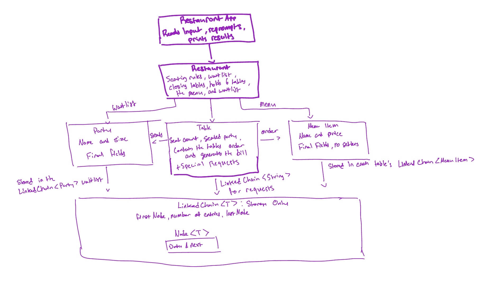

# Table Service: A Restaurant Floor Manager

CS 2114 · Project 2: Building for Reuse · Group 92 (Rahul Rajendran, Rohail Amjad, Brian Ding, Alex Chai)

Table Service is a terminal program where the user manages a small restaurant during a dinner shift. The manager seats arriving parties at the smallest open table that fits, keeps a waitlist with reservations and cancellations, takes orders from a menu, adds special requests, and prints each table's bill. When a table closes, the first waiting party that fits is seated automatically.

Everything is stored in one generic `LinkedChain<T>` that we modified from the provided class. The same class holds three element types: the waitlist (`LinkedChain<Party>`), each table's order (`LinkedChain<MenuItem>`), and each table's special requests (`LinkedChain<String>`).

## How to Compile and Run

**Requirements:** Java 17 JDK 17+ installed

### Option 1: Terminal / Command Prompt

1. Navigate to the source folder:
```bash
   cd cs2114-group92/src
```
2. Compile the program's source files:
```bash
   javac LinkedChain.java Party.java MenuItem.java Table.java Restaurant.java RestaurantApp.java
```
3. Run the program:
```bash
   java RestaurantApp
```
4. Use the numbered menu; choose **11** to quit.

### Option 2: Eclipse / VS Code

- Import the repository as an existing Java Project.
- Ensure JDK 17 (or class-standard Java) is configured on the build path, along with JUnit 4 and the course's `student.jar`.
- Right click `RestaurantApp.java` -> **Run As** -> **Java Application**.

### Running the Tests

- In Eclipse, right click the `src` folder -> **Run As** -> **JUnit Test**.
- This runs all six test classes: `LinkedChainTest`, `PartyTest`, `MenuItemTest`, `TableTest`, `RestaurantTest`, and `RestaurantAppTest`.

## System Diagram



## Attribution

| File | Team member(s) | Contribution (how) |
|---|---|---|
| `LinkedChain.java` | Rahul Rajendran | Revised the given LinkedChain class with AI assistance. The most notable change was adding a `lastNode` reference as a tail.<br>Specifically, I asked AI to draft code after explaining the functionality we wanted (e.g., "We want to easily add items at the end of the chain; how should we adjust the given methods as a result of adding the last node?"). |
| `LinkedChainTest.java` | Rahul Rajendran | Drafted using GenAI based on the initial tests from our spec's test plan, then hand-checked to ensure complete code coverage and that additional edge cases were handled. Manually updated the exception tests. Used AI by prompting for the specific cases I wanted after going through the spec doc. |
| `Party.java`, `MenuItem.java` | Rohail Amjad | Wrote both classes from the spec's signature tables with AI assistance (validation, getters, `toString`), then reviewed each method against the spec. |
| `Table.java` | Rohail Amjad, Rahul Rajendran | Rohail wrote the class with AI assistance from the spec and class design: seating, order handling, and the itemized bill in `close()`, checking each method's behavior and Big-O against the spec by hand. Rahul added the open-table check in `removeItem` and the special-requests stretch goal (`addRequest`, `getRequests`, requests on the bill), working through each change step by step with GenAI and verifying it with tests. |
| `PartyTest.java`, `MenuItemTest.java`, `TableTest.java` | Rohail Amjad, Rahul Rajendran | Rohail drafted with AI assistance from the spec's test plan, then added extra edge cases (too-big party, `fits`, empty-order bill). Rahul added `testIdenticalPartiesAreDifferent`, fixed `testRemoveItemNotThere`, and added the open-table and special-request tests. |
| `Restaurant.java` | Brian Ding | Implemented with AI assistance from the spec: fixed tables and menu, size-aware seating, waitlist reservations and cancellations, and closing tables with automatic seating of the first waiting party that fits. |
| `RestaurantTest.java` | Brian Ding | Drafted with AI assistance from the spec's test plan, including invalid inputs, duplicate party names, reservation positions, skipped parties, clean orders after seating, and independent array snapshots. |
| `RestaurantApp.java` | Alex Chai, Rahul Rajendran | Alex wrote the menu loop, input validation, and handlers with AI assistance. Rahul added the "Add a special request" option, made Quit a named constant, and made the blank-input message name what is blank. |
| `RestaurantAppTest.java` | Alex Chai, Rahul Rajendran | Drafted with GenAI from the scope's bad-input list, using scripted `Scanner` input to test each case, then reviewed by the team. Rahul updated the scripts for the new Quit number and added the special-request tests. |

**GenAI use:** We used Claude to initially understand what the assignment was asking for and the initial `LinkedChain` code, as well as draft the classes and test from the spec doc, and to double check out spec and code for inconsistencies. The entire team, double checked what was output by reading, running, and testing the code. After reviewing AI drafted code we were able to identify ourselves some key issues such as the `lastNode` bug in `remove(T)` and inconsistencies between the spec and initial code in `removeItem` and `getTable` which we eventually fixed.